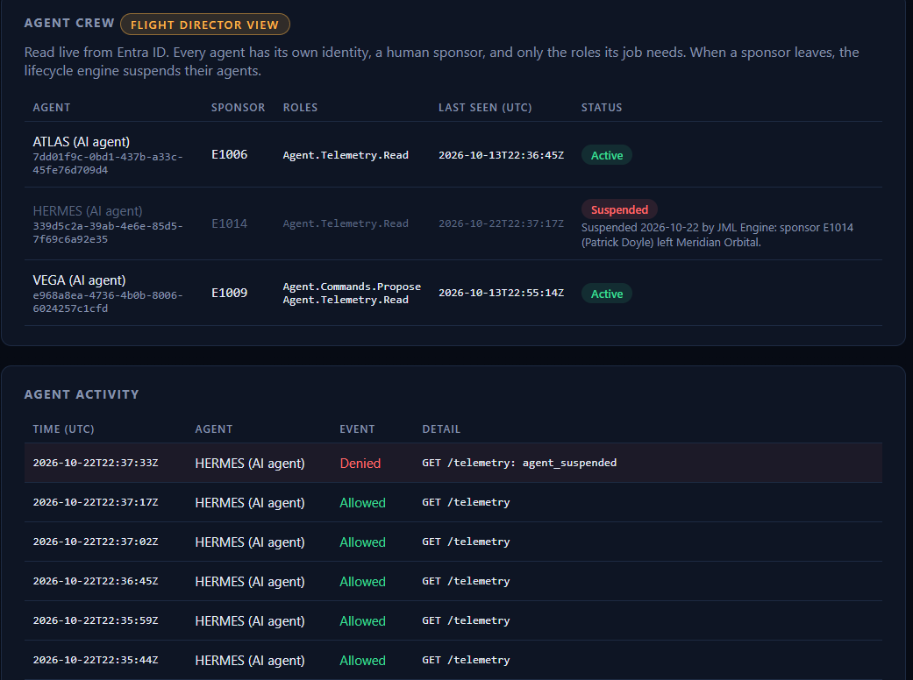
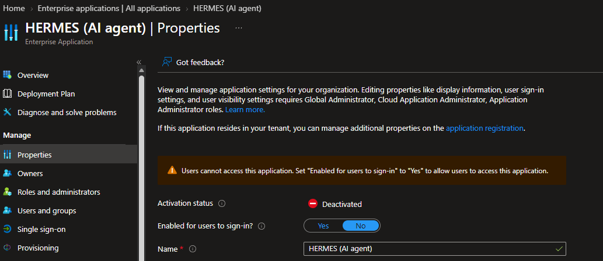
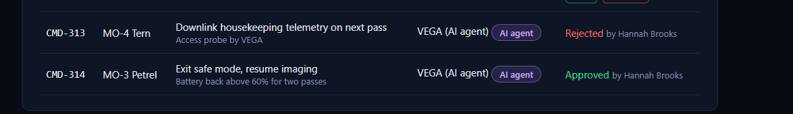
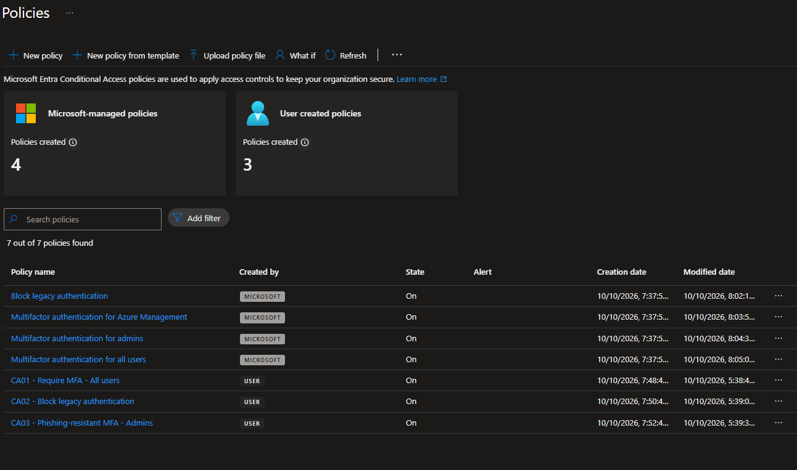
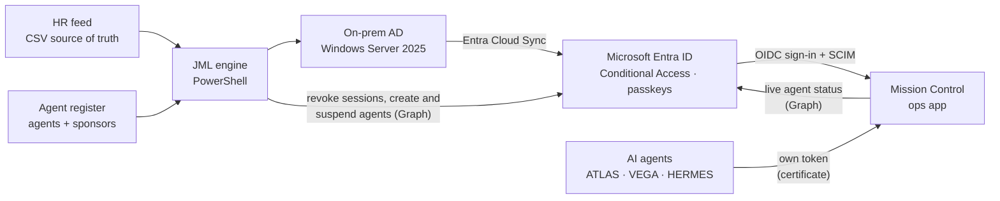
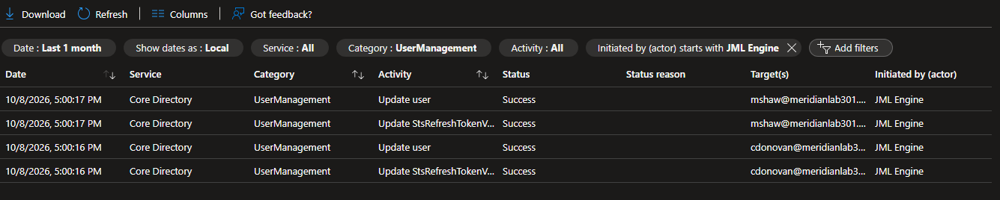

# Orbit

An identity and access lab for Meridian Orbital, a made-up satellite company with 50 employees and three AI agents.

It covers the whole account lifecycle:

- A PowerShell engine reads the HR file and creates, updates and disables accounts in Active Directory, which syncs to Microsoft Entra ID.
- Mission Control, a small web app, signs people in with Entra ID, gets its users over SCIM, and gives each person a role from their group.
- Conditional Access requires MFA for everyone and passkeys for admins.
- Each AI agent has its own Entra identity, an employee who sponsors it, and only the access its job needs. When the sponsor leaves, the same HR run that disables the sponsor also suspends the agent.

**Demo video (4½ min):** [watch on YouTube](VIDEO_LINK)

| | |
|---|---|
|  |  |
| HERMES is refused 16 seconds after its sponsor is offboarded, while its token is still valid. | The engine disabled HERMES in Entra ID in the same run. |
|  |  |
| VEGA, an agent, proposed both commands. Only a person can approve or reject them. | Conditional Access: MFA for all users, legacy sign-in blocked, passkeys for admins. |

## Architecture



## What it does

Day 1 provisions the 50-person crew from `hr_feed_day1.csv`. Day 2 (`hr_feed_day2.csv`) is the demo scenario. This is the real plan output:

```
Plan as of 2026-10-05: 0 Error | 2 Leaver | 2 Joiner | 0 Rehire | 2 Mover | 2 Deferred | 0 Orphan | 45 NoChange

Action   EmployeeId Account   Changes
Leaver   E1010      cdonovan  Disable account; Revoke Entra sessions; Reset password; -APP-MissionControl-Operators;
                              -FS-Telemetry-Read; -GG-All-Crew; -GG-MissionOps; Move to Disabled Crew
Leaver   E1045      mshaw     Disable account; Revoke Entra sessions; Reset password; -FS-IT-Modify; -GG-All-Crew; -GG-IT;
                              Move to Disabled Crew
Joiner   E1051      jcastillo Create in MissionOps; +APP-MissionControl-Operators; +FS-Telemetry-Read; +GG-All-Crew;
                              +GG-MissionOps; Manager: E1005
Joiner   E1052      aturner   Create in GroundSystems; +APP-MissionControl-Operators; +FS-Telemetry-Read; +GG-All-Crew;
                              +GG-GroundSystems; Manager: E1026
Mover    E1009      hbrooks   Title: 'Flight Controller' -> 'Flight Director'; Manager: 'E1005' -> 'E1004';
                              +APP-MissionControl-FlightDirectors; +GG-People-Leads
Mover    E1011      emccarthy Department: 'Mission Ops' -> 'Finance'; Title: 'Flight Controller' -> 'Accountant';
                              Manager: 'E1006' -> 'E1046'; +FS-Finance-Modify; +GG-Finance; -APP-MissionControl-Operators;
                              -FS-Telemetry-Read; -GG-MissionOps; Move to Finance
Deferred E1049      iwalsh    Termination effective 2026-11-13; no change yet
Deferred E1053                Starts 2026-11-02; account not created yet
```

- Erin moves from Mission Ops to Finance. She loses Mission Control and telemetry access in the same run, and SCIM deactivates her account in the app, even if she's signed in.
- Hannah is promoted to Flight Director and gets go/no-go approval rights.
- Chris leaves. He loses everything in one run, and the engine revokes his Entra sessions instead of waiting for the next sync cycle.



Day 3 (`hr_feed_day3.csv`) is the agent scenario: Patrick Doyle leaves, and he sponsors HERMES, the agent that writes the morning brief. One run with `-ManageAgents` does both:

```
Plan as of 2026-10-10: 0 Error | 1 Leaver | 0 Joiner | 0 Rehire | 0 Mover | 2 Deferred | 0 Orphan | 50 NoChange
Leaver   E1014      pdoyle  Patrick Doyle Disable account; Revoke Entra sessions; Reset password; ...
Agents: 0 Error | 1 Suspend | 0 Warn | 0 Held | 0 Unregistered | 2 NoChange
AgentSuspend HERMES Suspend: sponsor E1014 (Patrick Doyle) left Meridian Orbital
```

HERMES is running when it happens. Its next call to Mission Control is refused, even though its token is still valid for most of an hour.

## Design decisions

1. **HR is the source of truth, and `employeeID` is the anchor.** Names change; employee IDs don't. Accounts are matched on ID, never on name.
2. **Plan, then apply.** Every run builds a plan, prints it, and saves it as JSON. Nothing changes without `-Apply`, so a plan can be reviewed like a change ticket.
3. **The engine owns only the groups in `role-map.json`.** Access granted by hand or by a project is never read or removed.
4. **No privileged access by birthright.** Admin rights are meant to be just-in-time (PIM), never assigned by job title.
5. **Blast-radius guard.** If a run would disable more than `maxLeaverPercent` of enabled accounts, or that share is missing from the feed (a truncated export), it refuses to apply without `-Force`.
6. **Orphans are reported, never auto-disabled.** An enabled account missing from HR could be a contractor, a service account, or an HR error. A human decides.
7. **Leaver order is deliberate:** disable, revoke Entra sessions, reset password, strip groups, move to the Disabled Crew OU. An AD disable only reaches Entra on the next sync cycle, and refresh tokens stay valid until revoked. The engine therefore revokes sessions directly through Microsoft Graph, connecting app-only with a certificate (no client secret) and holding one permission, `User.RevokeSessions.All`.
8. **Apps re-verify sessions, too.** Revoking tokens in Entra doesn't touch an app's own session cookie. Mission Control re-checks every session with Entra every 60 seconds, so a revoked or disabled user is kicked out of the app, not just out of Microsoft 365.
9. **Nobody ever knows an initial password.** Joiner and leaver passwords are random, held as `SecureString`, and never logged. New hires onboard with a Temporary Access Pass and register a passkey.
10. **Untrusted input is validated.** Employee IDs are allow-listed, which blocks LDAP filter injection from the HR feed. Duplicates, bad dates, unknown statuses or missing columns fail the whole run instead of producing partial access.
11. **Testable by design.** The planners have no AD or Graph calls: 30 Pester tests cover joiners, transfers, leavers, deferrals, rehires, orphans, duplicate IDs, the safety guard, idempotency, and the agent sponsor rule. Mission Control has 47 pytest tests covering SCIM, roles, kick-out paths, agent tokens, and approvals.
12. **Agents are crew.** An agent never gets a shared key or a human's account. It gets its own Entra identity with a certificate (the private key never leaves the machine that runs it), a named human sponsor, and only the app roles its job needs.
13. **When the sponsor goes, the agent goes.** The JML engine suspends every agent whose sponsor has left, in the same run that disables the sponsor. A sponsor leaving on a future date triggers a warning first, so someone can take over the agent.
14. **Automation only takes access away.** The engine suspends agents but never re-enables one. Giving access back is a human decision.
15. **Least privilege for the engine, too.** Its Graph app holds two permissions: `User.RevokeSessions.All`, and `Application.ReadWrite.OwnedBy`, which lets it create agent identities and manage only the ones it created. It cannot grant an agent any access: a human admin approves each agent's roles.
16. **Token expiry isn't revocation.** An agent's token stays valid for an hour or more after its identity is disabled. Mission Control checks every agent's live status in Entra ID on every call (cached 15 seconds), and fails closed if it can't.
17. **Agents propose, humans decide.** Agents can read telemetry and draft commands; only a human Flight Director can approve one, and no agent can read crew records. There is no role that grants either, so it can't be granted by mistake.

## Repo layout

```
jml/
  Invoke-JmlSync.ps1          # runner: read AD -> plan -> (optionally) apply
  Initialize-LabDirectory.ps1 # one-time: OU tree, managed groups, UPN suffix
  Register-OrbitAgents.ps1    # gives each AI agent its own Entra identity
  JmlEngine.psm1              # pure planning logic (no AD calls)
  config/role-map.json        # department + title rules -> birthright groups
  config/agents.json          # agent register: each agent's job, sponsor and roles
  config/settings.example.json
  data/hr_feed_day1.csv       # the 50-person crew
  data/hr_feed_day2.csv       # demo scenario: 2 joiners, 2 movers, 2 leavers, 2 deferred
  data/hr_feed_day3.csv       # HERMES's sponsor leaves
  tests/JmlEngine.Tests.ps1   # Pester tests, no AD required
mission-control/              # the ops app: OIDC sign-in, SCIM 2.0, app roles, agent API (FastAPI)
mission-control/agents/       # the AI agents: certificates, CLI, HERMES on a local LLM
docs/lab-setup.md             # how to rebuild the lab from scratch
```

## Quickstart

```powershell
cd jml
Copy-Item config\settings.example.json config\settings.json   # then set upnSuffix
.\Initialize-LabDirectory.ps1 -AddUpnSuffix
.\Invoke-JmlSync.ps1 -HrFeed .\data\hr_feed_day1.csv           # dry run
.\Invoke-JmlSync.ps1 -HrFeed .\data\hr_feed_day1.csv -Apply
.\Invoke-JmlSync.ps1 -HrFeed .\data\hr_feed_day2.csv -Apply -RevokeCloudSessions
Invoke-Pester .\tests -Output Detailed
```

Lab build steps: [docs/lab-setup.md](docs/lab-setup.md). Mission Control setup and tests: [mission-control/README.md](mission-control/README.md).

## Roadmap

- [x] **Phase 1:** On-prem AD, Entra Cloud Sync, HR-driven JML engine with Graph session revocation
- [x] **Phase 2:** Mission Control with OIDC sign-in, app roles from group membership, SCIM 2.0 provisioning, and continuous session re-verification
- [x] **Phase 3:** Conditional Access baseline (MFA for all, block legacy auth, phishing-resistant MFA for admins), passkeys, TAP onboarding, monitored break-glass accounts
- [x] **Phase 4: Agent crew.** Three AI agents with their own identities and human sponsors, the sponsor rule in the JML engine, a token-checked agent API in Mission Control, and HERMES writing the morning brief on a local LLM. Setup: [mission-control/agents/README.md](mission-control/agents/README.md)
- [ ] **Next:** Intune device compliance; PIM and access reviews; Conditional Access for workload identities; migrating agents to Microsoft Entra Agent ID

All people, satellites and data in this repo are fictional.
